# Forest Guard AI

**Protecting Forests. Preventing Conflict. Saving Lives.**

A working, local-first platform for AI-assisted wildlife monitoring, GIS risk mapping and
human–wildlife conflict prevention. It was built for a solo-student hackathon submission and
runs end-to-end on one machine: real image/video inference, a geospatial risk engine, an alert
and response workflow, a guard console and a public community portal.

> **Scope and honesty.** Every camera, village, guard, detection and alert in the shipped demo
> dataset is **synthetic and labelled as such** in the UI and API payloads. There are no live
> camera feeds, no government surveillance access and no GPS collars. Uploaded media *is*
> genuinely analysed by the local AI pipeline. This is decision-support software, not a
> validated field system — see [AI limitations](docs/ai-limitations.md).

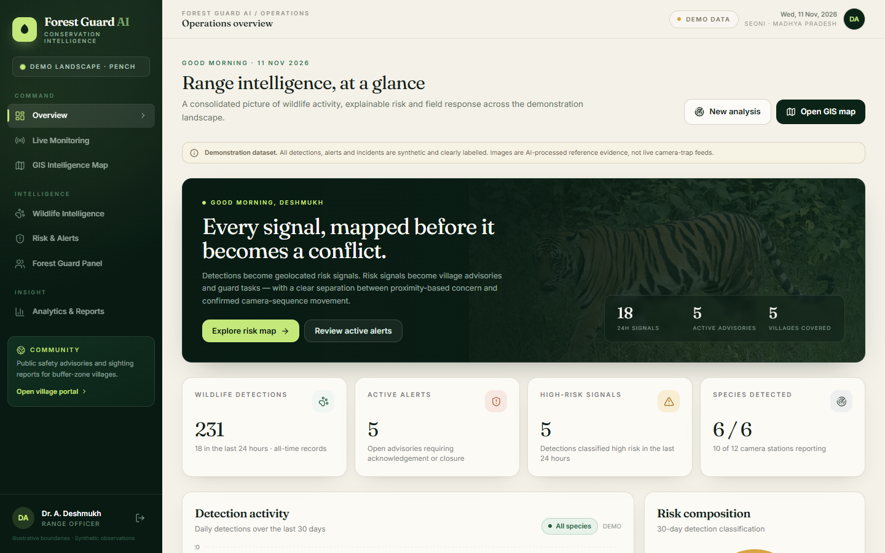

## What is actually implemented

| Area | Status | Notes |
| --- | --- | --- |
| Image & video AI detection | Built, runs locally on CPU | YOLO-World v2 localisation + CLIP ViT-B/32 zero-shot species classification; annotated output, confidence, species evidence, stored result |
| Open-dataset evaluation | Smoke check only | 6 licenced reference photos, 6/6 top-1. **Not** a benchmark or accuracy claim — [details](docs/ai-limitations.md) |
| GIS intelligence map | Built | Leaflet + OSM, clustered detections, forest/village polygons, cameras, guards, risk cells, alert coverage, tracks, filters, legend, detail panel |
| Explainable risk model | Built | Configurable weighted score (proximity, recency, frequency, incidents, movement) × species weight; low/moderate/high; admin-editable settings |
| Movement inference | Built, honest limits | Multi-camera association ≤24 h / ≤7 km / ≥3 points / ≥2 cameras. Never presented as GPS |
| Conflict alerts & workflow | Built | Threshold alerts, affected villages, guard assignment, acknowledge → respond → resolve, append-only audit trail |
| Forest guard panel | Built | Scoped task board, ack/respond/resolve, stats, RBAC (admin vs guard) |
| Community portal | Built (public) | Sanitised advisories, sighting/conflict reports with optional image, reference-code status check, safety guidance |
| Auth & RBAC | Built | PBKDF2 passwords, signed 12 h tokens, `admin` / `guard` roles; sensitive endpoints guard-only |
| Analytics & reports | Built | Trends, species mix, village exposure, response metrics, CSV export |
| Bilingual UI | Built | English / हिन्दी switcher on every page, saved preference, Devanagari typography, API-provided content translated in the client |
| Tests | Built | 28 pytest tests covering auth, seeding, risk, alerts, tracking, privacy and RBAC |

Everything button, filter, form and chart on the eight dashboard pages is wired to the API —
there are no dead controls or static mock screens. Screenshots in `docs/screenshots/` were
captured from the running app with Playwright (including a genuine tiger image upload and a
genuine community report submission), not generated as artwork.

## Screenshots

| | |
| --- | --- |
|  **01 · Overview** | 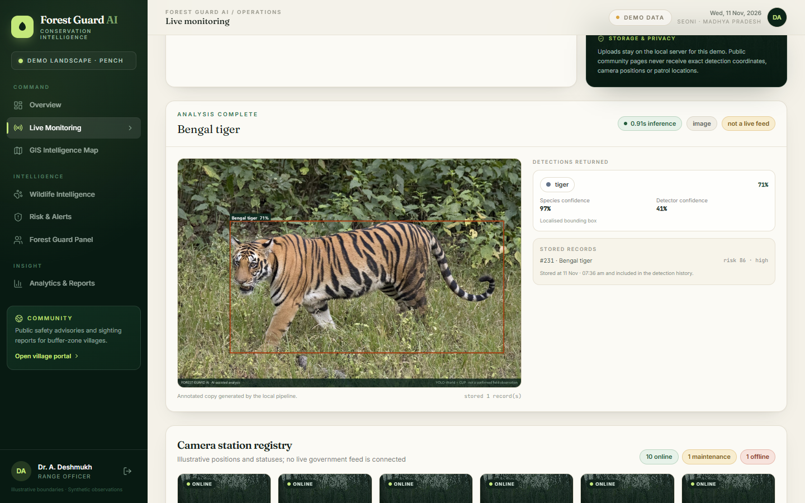 **02 · Live monitoring** (real AI upload) |
| 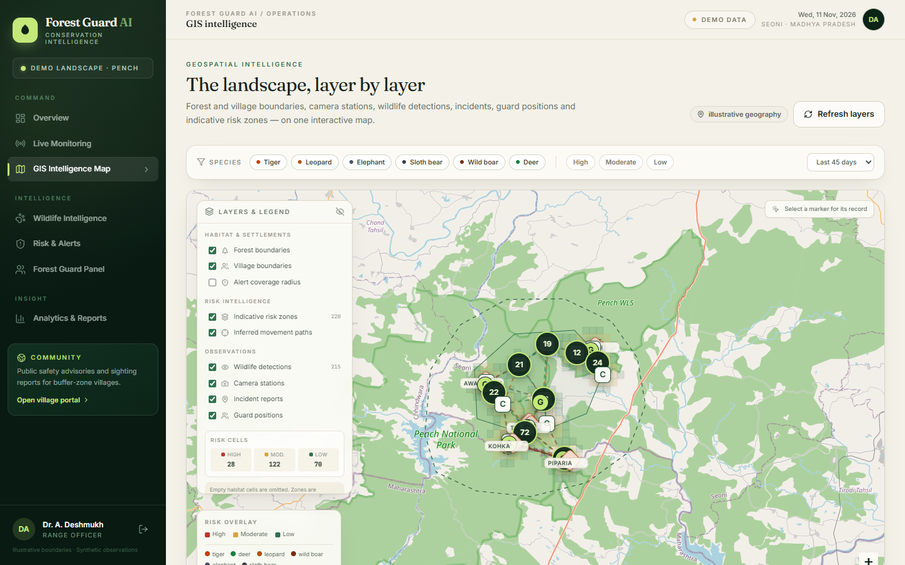 **03 · GIS intelligence map** | 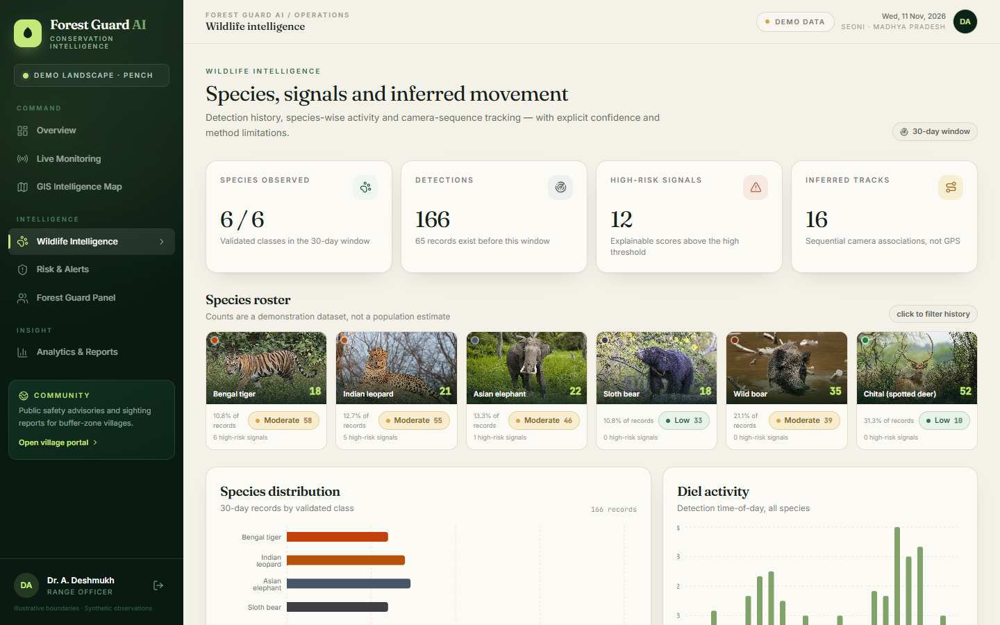 **04 · Wildlife intelligence** |
| 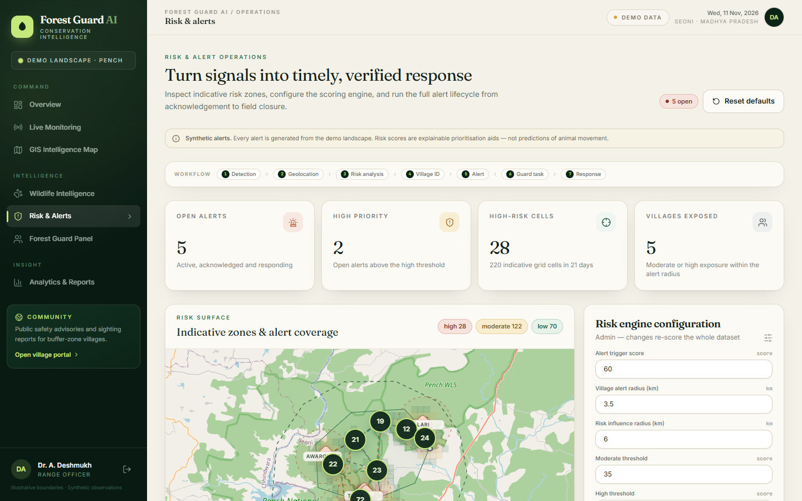 **05 · Risk & alerts** | 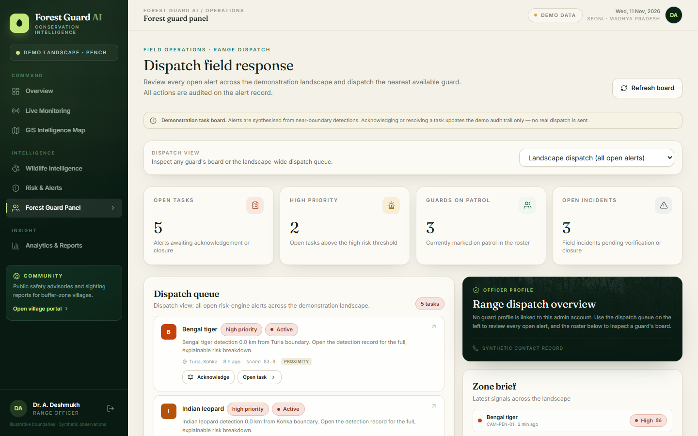 **06 · Guard panel** |
| 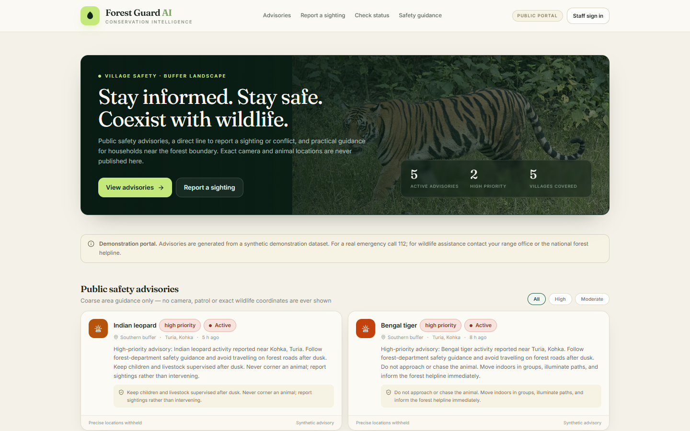 **07 · Community portal** | 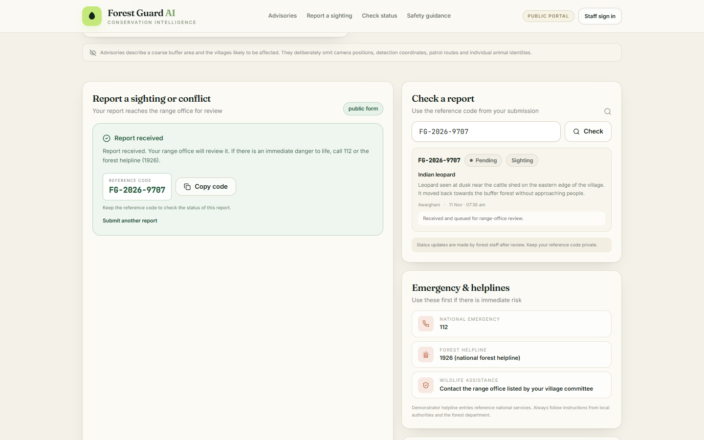 **08 · Report status** |
| 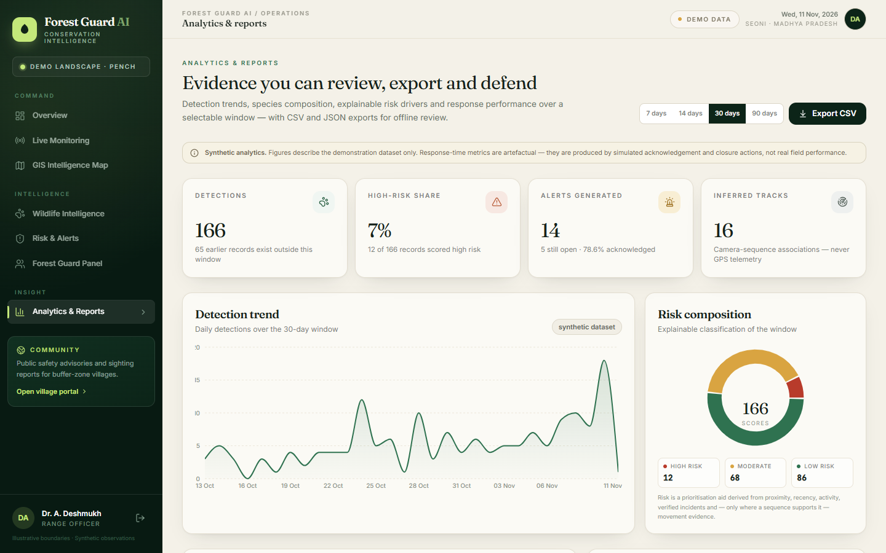 **09 · Analytics trends** | 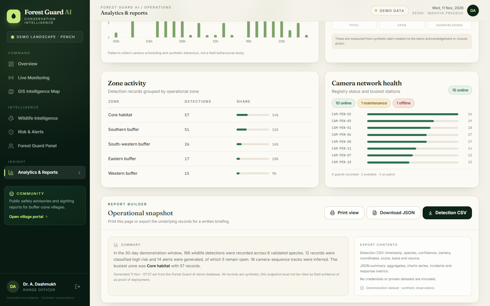 **10 · Reports & export** |

## Architecture

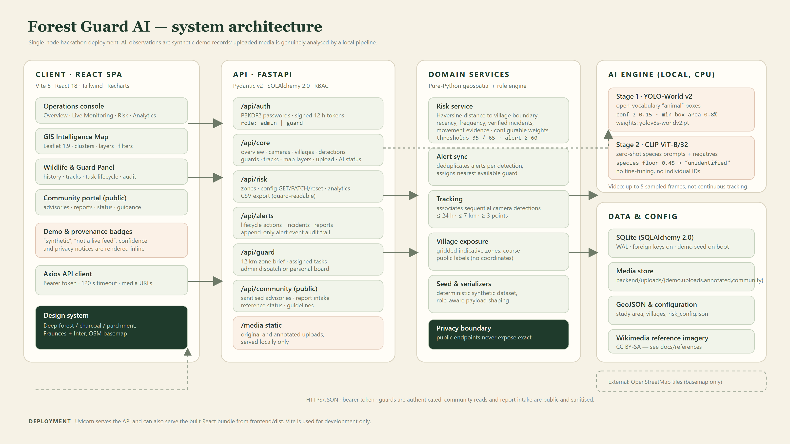

Single-node deployment: a React SPA talks to a FastAPI JSON API. The API owns authentication,
domain services (risk scoring, alert synchronisation, camera-sequence tracking, seeding) and
serves media. The AI engine loads YOLO-World v2 and CLIP on CPU on first upload. SQLite is the
database of record; the study area and village boundaries are GeoJSON. OpenStreetMap supplies
basemap tiles only — no user or wildlife data leaves the machine.

- [Full architecture notes](docs/architecture.md)
- [Detection → response pipeline](docs/diagrams/data_pipeline.png)
- [Risk model explained](docs/diagrams/risk_model.png)

## Quick start

**Requirements:** Python 3.11+ (tested on 3.14), Node 20+, ~1.5 GB free disk for model weights.
No GPU required. First AI run takes a few seconds to load the models.

```bash
# 1. Backend
python -m venv .venv
source .venv/bin/activate          # Windows: .venv\Scripts\activate
pip install -r requirements.txt
cp .env.example .env               # optional; defaults work as-is
python -m uvicorn backend.main:app --reload --port 8000
```

The first start creates `backend/database/forest_guard.db` and seeds the synthetic dataset
(5 villages, 12 cameras, 6 guards, 230 detections, 18 tracks, 13 alerts, 6 incidents).
API docs: <http://127.0.0.1:8000/docs>.

```bash
# 2. Frontend
cd frontend
npm install
npm run dev                        # http://127.0.0.1:5173
```

**Demo accounts** (intentionally public; change for any real deployment):

| Role | Email | Password |
| --- | --- | --- |
| Admin | `admin@forestguard.ai` | `forest123` |
| Guard | `guard@forestguard.ai` | `guard123` |

The community portal is public at `/community` and needs no login. The **EN / हिं** control
in the header (and on the login screen) switches the whole interface to Hindi; the choice is
remembered in the browser.

### Model weights

`yolov8s-worldv2.pt` (YOLO-World v2) must be present in the repo root, and CLIP `ViT-B-32.pt`
in the PyTorch cache (`pip install clip` then the first run downloads it). Weights are excluded
from git (`*.pt`). To skip the AI stack entirely, set `AI_MODE=demo`: uploads then return a
clear `503` instead of fabricating a result, and every other module still works.

```bash
AI_MODE=demo python -m uvicorn backend.main:app --port 8000
```

### Production-style build

```bash
cd frontend && npm run build        # emits frontend/dist
python -m uvicorn backend.main:app --port 8000
```

FastAPI serves the built SPA at `/` when `frontend/dist` exists, so one process hosts API, media
and UI. Set `SECRET_KEY` and change the demo passwords before exposing it to anyone.

## How it works

1. **Media** arrives as an upload (JPEG/PNG/WebP or a short MP4/MOV/WebM clip, up to 25 MB).
2. **Inference** — YOLO-World proposes `animal` boxes; CLIP scores each crop against six
   regional species plus negative prompts. Crops below the species floor are recorded as
   `unidentified` rather than forced into a class. Videos are sampled up to 5 frames.
3. **Geolocation** — a detection inherits its registered camera station's position. This is
   camera-station geography, not GPS.
4. **Risk** — a weighted, explainable score is computed against the nearest village boundary
   (see the risk diagram). Components and a written basis are stored on every alert.
5. **Alert** — detections at or above the threshold inside the alert radius create one alert
   (duplicates suppressed), list affected villages and assign the nearest available guard.
6. **Two audiences** — guards see exact detections and evidence; the public portal sees only
   coarse advisories and village names, never coordinates or cameras.
7. **Response** — acknowledge → assign → respond → resolve, each step appending an audit event;
   community reports get a reference code and a pending/verified status.

## Repository layout

```
backend/            FastAPI app, SQLAlchemy models, routers, services, seed data
  api/              auth · core · risk · alerts · guard · community routers
  services/         risk_service · alerts · tracking · seed · serializers
  models/ schemas/  ORM entities and Pydantic contracts
ai_engine/          two-stage detector, annotation, thresholds
geospatial/         Haversine, point-in-polygon, risk analysis, study-area GeoJSON
frontend/           React 18 + Vite + Tailwind + Leaflet + Recharts SPA
  src/pages/        the eight dashboard pages + login
  scripts/          screenshot capture and diagram rendering (Playwright + Edge)
demo_data/          synthetic assets: wildlife reference images, annotated detection frames,
                    risk configuration
docs/               architecture, setup, testing, demo script, AI limits, credits, diagrams,
                    screenshots, evaluation JSON
tests/              pytest suite (temp DB, demo AI mode)
tools/              species evaluation harness
deliverables/       generated PPTX / PDF / DOCX
```

## Testing

```bash
python -m pytest -q        # 28 passed
cd frontend && npm run build   # production bundle
```

The suite runs against a temporary SQLite database with `AI_MODE=demo`, so it never touches the
demo database, never downloads weights and never needs a GPU. See [testing](docs/testing.md).

## Privacy and integrity by design

- Synthetic data is labelled in the UI (demo badges) and in API payloads (`synthetic` flags,
  `data_source` fields). Nothing is presented as a real observation.
- Public endpoints return aggregated risk and village names only. Coordinates, camera codes and
  exact detection locations are stripped server-side, not just hidden in the UI.
- Tracks are inferred from sequential camera observations and are labelled as inference; no GPS
  telemetry is implied anywhere.
- Uploads are stored locally and analysed once. There are no external inference calls.
- No API keys, `.env` files, private datasets or credentials are committed; the demo passwords
  are deliberately public and documented as such.

## Documentation

| Document | Contents |
| --- | --- |
| [docs/setup.md](docs/setup.md) | Prerequisites, install, environment variables, troubleshooting |
| [docs/architecture.md](docs/architecture.md) | Components, data model, request flows, design decisions |
| [docs/testing.md](docs/testing.md) | Test strategy, what each suite covers, how to re-run screenshots |
| [docs/demo-script.md](docs/demo-script.md) | 5-minute judge walkthrough |
| [docs/ai-limitations.md](docs/ai-limitations.md) | Model design, thresholds, smoke evaluation, open-dataset plan |
| [docs/image-credits.md](docs/image-credits.md) | Licence and attribution for every image |
| [docs/api.md](docs/api.md) | Endpoint summary with auth requirements |
| [docs/references/ai_smoke_evaluation.json](docs/references/ai_smoke_evaluation.json) | Raw evaluation output |

## Known limitations

- Single-node SQLite; no concurrent-write clustering or PostGIS. The GeoJSON fallback is
  intentional so the project runs without a database server.
- Species classification is zero-shot CLIP over six labels; it is not fine-tuned and will
  confuse visually similar species, especially at night or in low resolution.
- Alerts are simulated (no SMS/email dispatch). Guard assignment is nearest-available, not
  schedule-aware.
- The study area is an illustrative landscape near Seoni, Madhya Pradesh; boundaries,
  populations and cameras are fabricated for demonstration.
- Screenshot and diagram capture scripts depend on a local Microsoft Edge install.

## Credits and licence

Wildlife reference imagery is CC BY-SA / CC BY-SA-compatible and individually attributed in
[docs/image-credits.md](docs/image-credits.md). Basemap © OpenStreetMap contributors. Code in
this repository was written for this project; no third-party dashboard templates are used.
