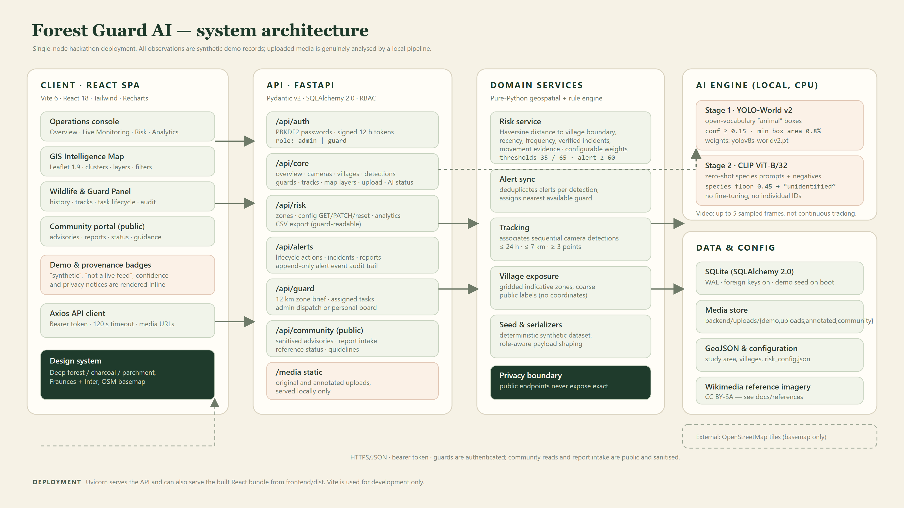
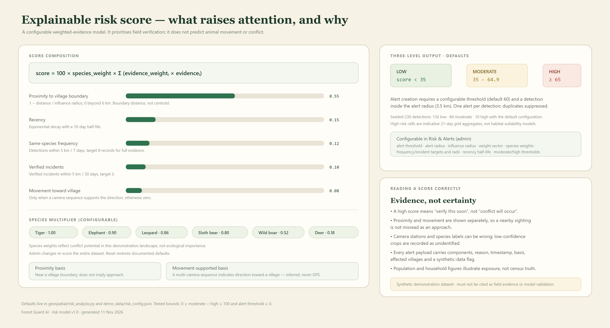

# Architecture



## 1. Shape of the system

Forest Guard AI is a single-node application with three runtimes:

| Runtime | Technology | Responsibility |
| --- | --- | --- |
| Web client | React 18, Vite 6, Tailwind 3.4, Leaflet 1.9, Recharts | Eight dashboard pages, public portal, map rendering, forms and filters |
| API | FastAPI, Pydantic v2, SQLAlchemy 2.0 | Authentication, RBAC, domain logic, validation, media serving, CSV export |
| Inference | PyTorch, Ultralytics YOLO-World v2, OpenAI CLIP | Manual uploads only; loaded lazily on the first analysis request |

SQLite is the database of record. Column types are portable and the ORM is declarative, so a
move to PostgreSQL/PostGIS is a connection-string change plus geometry columns — but nothing in
this build requires a database server, which is deliberate for a hackathon laptop.

The frontend is a static bundle. In development Vite proxies `/api` and `/media`; in production
`backend.main` mounts `frontend/dist` at `/`, giving one process and one origin.

## 2. Backend layers

```
backend/
  main.py              app factory, CORS, lifespan (init_db + optional seed), static mounts
  config.py            env-driven settings, absolute paths, upload folders
  database/session.py  engine, SessionLocal, init_db, SQLite PRAGMAs
  api/                 routers (auth, core, risk, alerts, guard, community) + deps + utils
  services/            risk_service, alerts, tracking, seed, serializers
  models/entities.py   ten SQLAlchemy entities
  schemas/api.py       Pydantic request/response contracts
```

Routers stay thin: they resolve the current user, validate input and delegate to services.
Serializers shape payloads per audience, which is how the public/guard privacy boundary is
enforced in one place rather than in each route.

### Request authentication

- `POST /api/auth/login` verifies a PBKDF2-HMAC-SHA256 hash (240 000 iterations, per-user salt)
  and returns an itsdangerous-signed token valid for 12 hours.
- The token is sent as `Authorization: Bearer <token>`.
- `deps.py` resolves the user and exposes `require_admin` / `require_guard` dependencies.
- Community endpoints (`/api/community/*`) are intentionally unauthenticated but return only
  sanitised data.

## 3. Data model

| Entity | Purpose | Notable fields |
| --- | --- | --- |
| `User` | Console login | email, password hash, role (`admin`/`guard`), guard link |
| `Village` | Exposure target | name, population, households, boundary polygon (GeoJSON text), centroid |
| `Camera` | Observation station | code, name, lat/lon, zone, status, install date |
| `Guard` | Field responder | name, badge, phone, home station, availability |
| `Detection` | One analysis result | species, confidence, bbox, media paths, timestamp, camera, synthetic flag, risk score/level |
| `Track` | Inferred movement | species, ordered detection ids, camera sequence, distance, direction, confidence, evidence note |
| `Incident` | Verified conflict | type, severity, village, status, description, timestamp |
| `SightingReport` | Community submission | reference code, type, species, village, description, image, status |
| `Alert` | Conflict-prevention task | detection link, risk score/level, reason, affected villages, assigned guard, status, timestamps |
| `AlertEvent` | Append-only audit | alert, actor, action, note, created_at |

Detections are the spine: risk is scored per detection, alerts reference detections, and tracks
reference detection ids in sequence. `AlertEvent` rows are never mutated, so the response history
is reconstructible.

## 4. AI pipeline

Two stages, both local and CPU-only:

1. **Localisation** — YOLO-World v2 is configured with the single open-vocabulary class
   `animal`. Boxes below 15 % confidence or 0.8 % of frame area are discarded. This avoids
   fine-tuning a detector for six species while still using a real object-detection model.
2. **Classification** — each crop is compared against CLIP text embeddings for six species
   (multiple prompts each, plus negative prompts such as empty forest or vehicle). Softmax over
   positive prompts yields a species and probability. Below `0.45` the crop is stored as
   `unidentified`; there is a separate full-frame path for tight crops with a `0.62` floor.

Videos are sampled up to five frames; this is not continuous tracking. Annotated copies are
written to `backend/uploads/annotated/` and referenced by the detection. The engine is a
process-wide singleton guarded by a lock, so concurrent uploads serialise inference rather than
loading models twice.

Configuration defaults live in `ai_engine/config.py`. Threshold rationale and evaluation limits
are documented in [ai-limitations.md](ai-limitations.md).

## 5. GIS and risk model



No geospatial server is used. `geospatial/` implements:

- **Haversine distance** on a spherical Earth for all proximity maths.
- **Point-in-polygon** ray casting for village membership and study-area checks.
- **Boundary distance** from a detection to the nearest village polygon edge, not its centroid —
  a sighting at the forest edge is genuinely close even when the village centre is far.
- **Gridded risk cells** (0.0075° ≈ 800 m) computed over the study area for the map layer.

The score is intentionally linear and explainable:

```
score = 100 × species_weight × Σ(weight_i × evidence_i)
```

| Component | Default weight | Evidence |
| --- | --- | --- |
| Proximity | 0.55 | 1 − distance / influence radius (6 km), clamped to 0 |
| Recency | 0.15 | Exponential decay, 10-day half-life |
| Same-species frequency | 0.12 | Detections within 5 km / 7 days, target 8 |
| Verified incidents | 0.10 | Incidents within 5 km / 30 days, target 3 |
| Movement toward village | 0.08 | 1 only if a camera sequence supports direction; otherwise 0 |

Species multipliers: tiger 1.00, elephant 0.90, leopard 0.86, sloth bear 0.80, wild boar 0.52,
deer 0.18. Thresholds: low < 35 ≤ moderate < 65 ≤ high. Alerts require a score ≥ 60 **and** a
detection within 3.5 km of a village boundary; the alert lists every village inside that radius
and records the score components and a human-readable basis.

Every number above is editable at runtime by an admin (**Risk & Alerts → Configuration**). Saving
recomputes the whole dataset so map, charts and alerts stay consistent; reset restores the
defaults in `demo_data/risk_config.json`.

## 6. Movement inference

`services/tracking.py` groups detections by species and builds sequences only when evidence is
sufficient:

- consecutive detections ≤ 24 hours apart;
- consecutive cameras ≤ 7 km apart;
- at least 3 detections across at least 2 cameras.

For each track it derives total distance, direction relative to the nearest village
(toward / away / parallel), and a confidence band. Tracks are recomputed after new detections.
The UI states that these are inferred camera-to-camera movements, never GPS telemetry. Each
track payload carries `method` ("Sequential camera detections (spatial-temporal association)"),
`direction`, `confidence` and a fixed `disclaimer` string; path points are the registered camera
station positions only.

## 7. Alert lifecycle

```
detection → score → threshold + radius check → alert (dedup by detection)
        → affected villages → nearest available guard → guard notification (simulated)
        → acknowledge → respond → resolve
```

- Duplicate suppression is one alert per detection.
- Each action appends an `AlertEvent` with actor, action, note and timestamp.
- Guard users only see alerts assigned to their linked guard record (or unassigned, depending on
  the dashboard filter); admins see everything and can dispatch.
- Notifications are simulated in-app. No SMS or email is sent, and the UI says so.

## 8. Privacy boundary

The public portal is a different view of the same data, not a different database:

| Public (sanitised) | Guard / admin |
| --- | --- |
| Coarse risk level and affected village names | Exact coordinates, camera codes, detection media |
| Advisory text and safety guidance | Species confidence, bounding boxes, evidence chain |
| Report reference code and status | Reporter contact details and moderation fields |
| Aggregated counts | Per-detection and per-alert records |

Sanitisation happens server-side in `serializers.py` / `routes_community.py`; the browser never
receives coordinates it must then hide. Tests assert that forbidden keys are absent from public
payloads.

## 9. Frontend structure

```
frontend/src/
  pages/        Overview, LiveMonitoring, GISMap, Wildlife, RiskAlerts, GuardPanel,
                CommunityPortal, Analytics, Login
  components/   MapView (Leaflet + markercluster), layout, cards, charts, tables, modals
  api/          axios client with bearer token injection and error normalisation
  context/      auth state, toast/notification state
```

`MapView` is deliberately thin over Leaflet rather than a React wrapper: layers (forest polygon,
village polygons and labels, camera markers, clustered detections, risk cells, alert radius
circles, tracks) are added and removed imperatively as filters change. Detail panels are driven
by map clicks. All pages share a design system of deep forest green, charcoal, parchment and
lime accents, with Fraunces for headings and Inter for UI text.

## 10. Seeding and determinism

`services/seed.py` uses a fixed random seed to generate the landscape and 60 days of history:
5 villages (Turia, Kohka, Awarghani, Sillari, Piparia), 12 cameras, 6 guards, 230 detections,
18 tracks, 13 alerts and 6 incidents. Species choices, timestamps and camera assignments are
stable across resets, which makes screenshots, tests and the demo script reproducible.

Real photographs from `demo_data/detection_images/` are attached to a subset of detections as
"evidence" thumbnails. They were produced by running the actual engine over licenced Wikimedia
photos (see [image-credits.md](image-credits.md)); the events themselves remain synthetic and
are labelled as such.

## 11. Deliberate trade-offs

| Decision | Why | Cost |
| --- | --- | --- |
| SQLite instead of PostGIS | Zero-setup, portable demo | No spatial indexing; polygons are parsed in Python |
| Open-vocabulary detector | Six classes without training data | Lower precision than a fine-tuned camera-trap model |
| Zero-shot CLIP classifier | No labelled training set | Confuses similar species; not a field-validated classifier |
| Direct Leaflet | Full control of clustering, polygons and filters | More imperative code than a React wrapper |
| Synchronous inference | Simple, honest request/response | Upload can take seconds on CPU |
| Signed tokens in localStorage | Minimal auth surface | No refresh/revocation list; fine for a demo |
